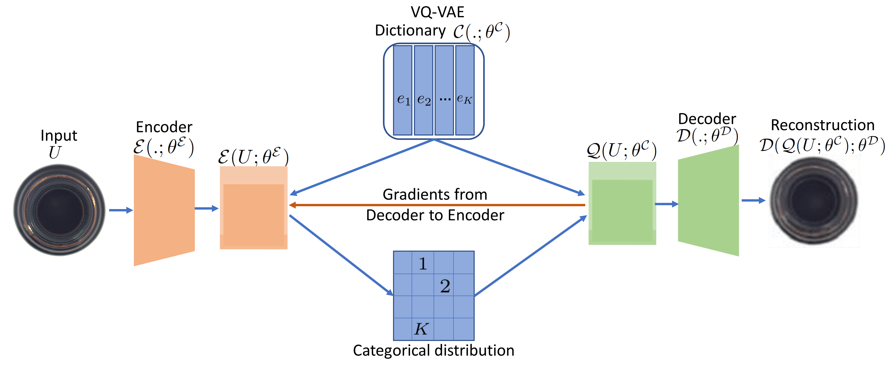
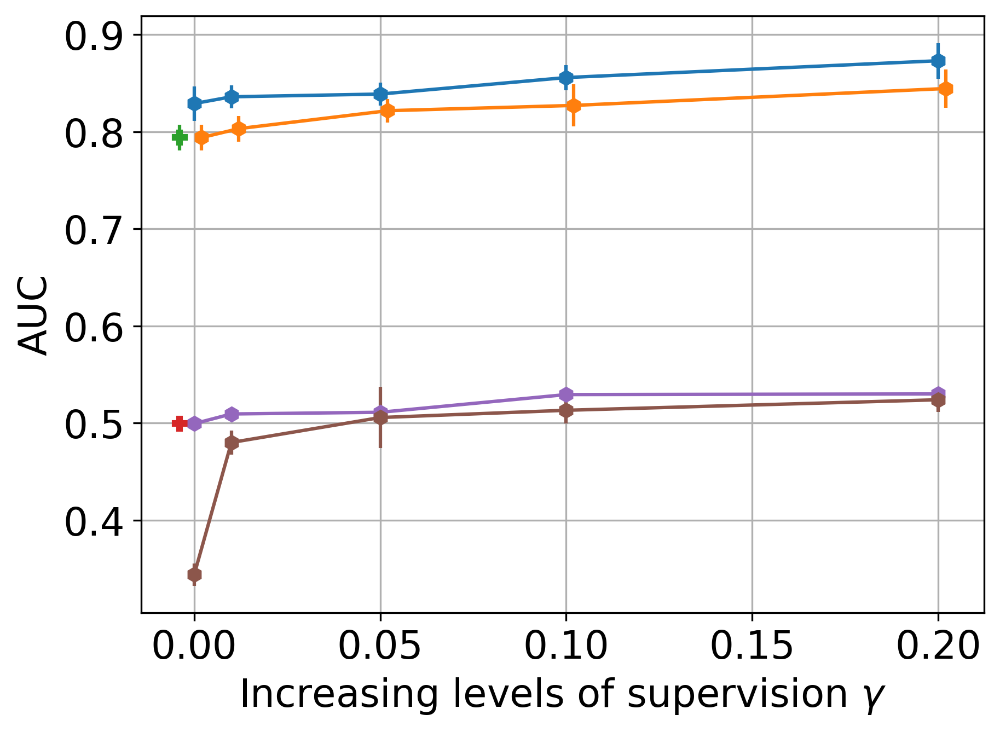
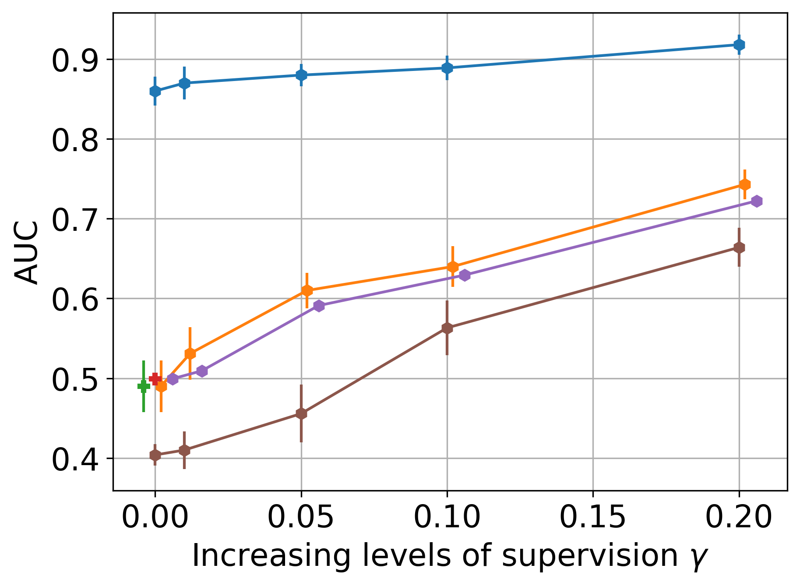
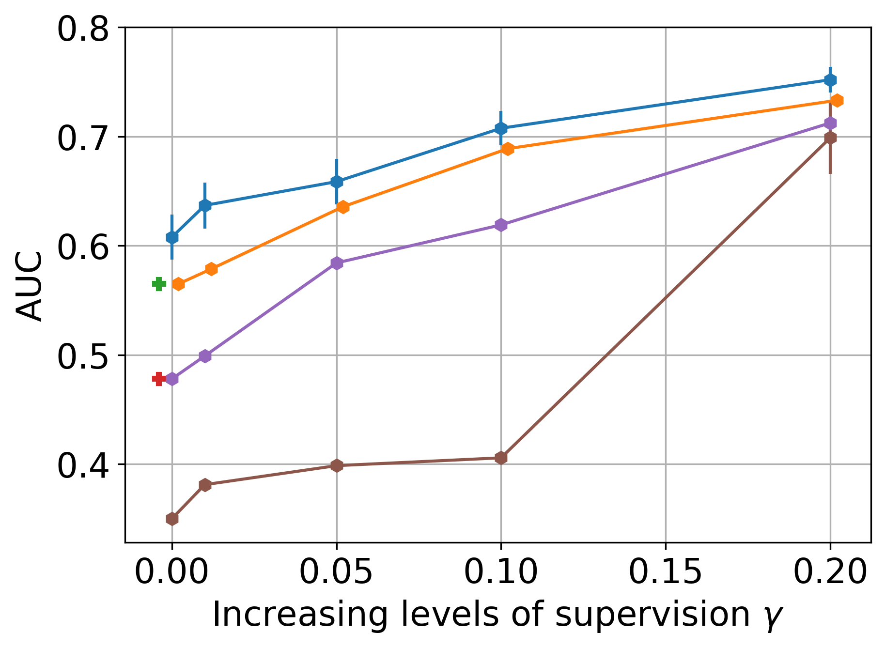
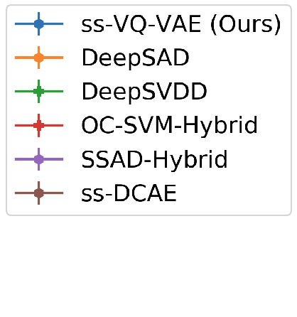

# ss-VQ-VAE (DICTA 2023) — thesis Chapter 6

Code for the **semi-supervised vector-quantized VAE** experiments in the DICTA 2023 paper and PhD thesis Chapter 6.

> This repository is **not** the ss-gVAE (WACV 2022), RU-VAE / c-ss-gVAE (ISBI 2022), or c-ss-ms-gVAE (Neurocomputing) codebase. For those, see [`RenukaSharma/ss-gVAE`](https://github.com/RenukaSharma/ss-gVAE), [`RenukaSharma/c-ss-gVAE`](https://github.com/RenukaSharma/c-ss-gVAE), and [`RenukaSharma/c-ss-ms-gVAE`](https://github.com/RenukaSharma/c-ss-ms-gVAE).

## Paper

- **DICTA 2023:** [Deep Semi-supervised Anomaly Detection Using VQ-VAE](https://ieeexplore.ieee.org/document/10410934/)
- **DOI:** [10.1109/DICTA60407.2023.00045](https://doi.org/10.1109/DICTA60407.2023.00045)
- Camera-ready PDF: [`DICTA23_camera_ready.pdf`](DICTA23_camera_ready.pdf)
- Poster: [`paperID_37_poster_RenukaSharma_DICTA23.pdf`](paperID_37_poster_RenukaSharma_DICTA23.pdf)
- Short talk (GIF): [`paperID_37_5minpresentation_DICTA23_ss_VQ_VAE.gif`](paperID_37_5minpresentation_DICTA23_ss_VQ_VAE.gif)

The paper introduces **ss-VQ-VAE**: VQ-VAE dictionary learning with a loss on a small set of labeled anomalies, and an anomaly score that compares encoder features to the quantized dictionary embeddings.

## Scope of this release

Dataset loaders from the original research tree are kept. The CLI names in `src/main.py` are:

| Dataset (CLI name) | Typical `net_name` | Notes |
|--------------------|--------------------|--------|
| `mvtec` | `vq_vae_net` | Paper dataset; `--category` (carpet, bottle, …) |
| `corrosion` | `vq_vae_net` | Paper dataset; cached `.pt` patches under `--data_path` |
| `malaria_dataset` | `cifar10_LeNet` or `malaria_net` | Loader kept; not a DICTA table |
| `nanofibre` | `nanofibre_vae` | Loader kept |
| `mnist`, `fmnist`, `cifar10` | `*_LeNet` or `vq_vae_net` | Toy / one-vs-rest setups |
| ODDS names (`arrhythmia`, …) | `*_mlp` | Tabular Deep SAD leftovers |

Supporting code lives under `src/` (ss-VQ-VAE training, SSAD hybrid baseline) and `binary_classifier/` (binary-classifier baseline).

## Results (your figures)

Figures below are the thesis Chapter 6 / DICTA plots (from `Chapter_06_pics`), stored in [`docs/figures/`](docs/figures/). They are **not** copied from the ss-gVAE, c-ss-gVAE, or c-ss-ms-gVAE repositories.

### Method overview

<p align="center">
  
</p>

> **Figure 1.** Semi-supervised VQ-VAE (ss-VQ-VAE) framework for one-class classification. From thesis Chapter 6 / the DICTA 2023 paper.

### MVTec (bottle, carpet) and corrosion

<p align="center">
  
  &nbsp;
  
</p>

<p align="center">
  
  &nbsp;
  
</p>

t-SNE panels (carpet and corrosion, ss-VQ-VAE vs Deep SAD) are in [`docs/figures/tsne/`](docs/figures/tsne/).

## Quick start

```bash
export DATA_DIR=$HOME/data/mvtec
export RESULTS_DIR=$HOME/results/ss-vq-vae
./scripts/run_experiment.sh mvtec vq_vae_net --category carpet --pretrain False
```

See [`docs/reproducing_paper.md`](docs/reproducing_paper.md) for environment setup, data layout, and more commands. The many `run_*.sh` files in this working tree are local-only (gitignored) and are not published.

## Place in the PhD thesis

This work is **Chapter 6** of the PhD thesis *"Anomaly Detection in Images Using One-class and Multi-class Learning Approaches"* (Renuka Sharma, IITB-Monash Research Academy, 2022). The conference version appeared at DICTA 2023.

- Monash Bridges: <https://bridges.monash.edu/articles/thesis/Anomaly_Detection_in_Images_Using_One-class_and_Multi-class_Learning_Approaches/23584503>
- DOI: [`10.26180/23584503`](https://doi.org/10.26180/23584503)

Companion repositories from the same thesis:

| Chapter | Topic | Repository |
| ------- | ----- | ---------- |
| Ch. 3 | ss-gVAE (WACV 2022) | [`ss-gVAE`](https://github.com/RenukaSharma/ss-gVAE) |
| Ch. 4 | RU-VAE (ISBI 2022) | [`c-ss-gVAE`](https://github.com/RenukaSharma/c-ss-gVAE) |
| Ch. 5 | c-ss-ms-gVAE (Neurocomputing) | [`c-ss-ms-gVAE`](https://github.com/RenukaSharma/c-ss-ms-gVAE) |
| Ch. 6 | ss-VQ-VAE (DICTA 2023) — **this repository** | [`ss-vq-vae`](https://github.com/RenukaSharma/ss-vq-vae) (here) |

## Citation

See [`CITATION.cff`](CITATION.cff) for software metadata and the **preferred citation** to the DICTA paper. If you cite the repository software separately, credit the maintainer listed there.

```bibtex
@inproceedings{Sharma2023DICTA,
  title     = {Deep Semi-supervised Anomaly Detection Using {VQ-VAE}},
  author    = {Sharma, Renuka and Shi, Hengcan and Cai, Jianfei and Awate, Suyash P. and Birbilis, Nick},
  booktitle = {2023 International Conference on Digital Image Computing: Techniques and Applications (DICTA)},
  pages     = {273--280},
  year      = {2023},
  publisher = {IEEE},
  doi       = {10.1109/DICTA60407.2023.00045}
}
```

Scientific authorship for the conference paper is exactly as in the citation above. Assistance with repository preparation, editing, or tooling does **not** constitute co-authorship of the paper.

## License

[MIT](LICENSE). Built upon Deep SAD (Ruff *et al.*, 2020), also MIT-licensed.
